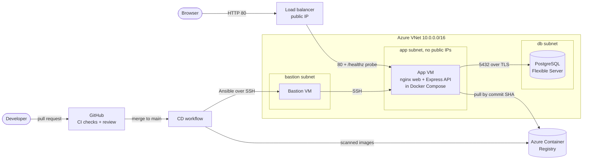

# Hoard

> **Know where your MoMo went.** A spending and budget tracker for young Rwandans who pay mostly with mobile money and cash.

**Live app:** [http://102.133.171.40](http://102.133.171.40) · [Health](http://102.133.171.40/api/health) · [Architecture](#architecture) · [Deployments](https://github.com/El-Gibbor/Hoard/deployments/production) · [Operations](#operations) · [Changelog](CHANGELOG.md)

## Problem Statement

University students and young professionals in **Kigali, Rwanda**, handle most of their money through mobile money (MTN MoMo, Airtel Money) and cash. Many budgeting apps work from bank-statement data, but most young Rwandans are not banked. Their spending is spread across small MoMo transfers, merchant payments and cash, with no single place to see it, and they run out of money before the month ends.

The evidence:

- **Mobile money is how Rwandans handle money.** In FinScope 2024, 86% of adults own or have used mobile money and 77% have a registered wallet in their own name, while only about 22% are banked. ([NISR – FinScope 2024](https://microdata.statistics.gov.rw/index.php/catalog/120/overview), [KT Press](https://www.ktpress.rw/2024/06/finscope-2024-shows-progress-in-rwandas-financial-inclusion/))
- **Young people are short of money and borrow informally.** About 66% of Rwandan youth borrowed money in the previous 12 months, but only 16% borrowed from formal institutions. ([Access to Finance Rwanda youth report, via The New Times](https://www.newtimes.co.rw/article/188894/News/88-percent-of-rwandan-youth-are-financially-included-a-new-report/amp))
- **Young users can handle a digital tool but lack financial knowledge.** A survey of 300 Rwandans aged 18–32 found average financial knowledge, moderate digital literacy and gaps in money practices. ([Preprints.org](https://www.preprints.org/manuscript/202601.0737/v1))

Hoard lets users record expenses by payment method in Rwandan francs, set a monthly budget, and see straight away whether they are within, approaching or over it.

## Target Users

| User | Who they are | What they need |
| --- | --- | --- |
| **Students** (primary) | University students in Kigali living on allowances, stipends or part-time income | Stretch a fixed monthly amount and avoid running out before month end |
| **Young professionals** | Early-career workers aged 18–32, often paid into a MoMo wallet | See where money goes across MoMo, cash and bank |
| **Admins** | Platform operators | Manage spending categories and view platform-wide insights |

## Value Proposition

Hoard is built for people whose money moves through a MoMo wallet and their pocket, not a bank account.

| What young Rwandans use today | Where it falls short | What Hoard does instead |
| --- | --- | --- |
| Budgeting apps that import bank statements | About 78% of adults are not banked, so there is nothing to import | Expenses are logged directly, with no bank account or statement needed |
| MoMo and Airtel Money transaction history | One wallet at a time, no categories, no budget, and cash is missing | MTN MoMo, Airtel Money, cash, card and bank transfer sit side by side in one monthly view |
| Notebooks and spreadsheets | Totals are worked out by hand, usually after the money has run out | Spending is totalled automatically against the month's budget |
| Generic finance apps | Built around dollars or euros and Western spending categories | Whole Rwandan francs, and local categories such as Airtime & Data and Savings Group (Ikimina) |

- **One clear signal, early.** Instead of raw numbers, the budget shows *within*, *approaching* (from 80% spent) or *over*, so a student sees the warning while there is still time to adjust.
- **Light and web-based.** It runs in a phone browser on mobile data, with nothing to install.

## Core Features

1. **Expense tracking:** log, edit and delete expenses in RWF with a category, date, payment method (MTN MoMo, Airtel Money, cash, card, bank transfer) and notes. Search, filter and sort them.
2. **Monthly budget:** set a budget per month and see the amount spent, the amount remaining and a *within / approaching / over* status.
3. **Personal dashboard:** monthly total, remaining budget, highest expense, and spending by category and by payment method.
4. **Accounts and admin:** sign up and sign in with user and admin roles. Admins manage categories and view platform insights.

## Technology Stack

| Layer | Technology |
| --- | --- |
| Frontend | React, TypeScript, Vite, React Router, Redux Toolkit |
| Backend | Node.js, TypeScript, Express, Zod, JWT |
| Database | PostgreSQL with Prisma ORM |
| Testing | Vitest, Supertest |
| DevOps | Docker, Docker Compose, GitHub Actions, Trivy, Checkov |
| Infrastructure | Azure (VNet, VMs, Load Balancer, PostgreSQL Flexible Server, Container Registry), Terraform, Ansible |

## Getting Started

### Prerequisites

- Node.js 20 or newer
- npm 10 or newer
- Docker with Docker Compose v2 (the `docker compose` command, with a space). It runs the full stack, and the other setups below use it for the local Postgres database. Compose publishes Postgres on port 5433 so it does not clash with another Postgres already using 5432.

### Run everything with Docker Compose

This is the quickest way to run Hoard. Running the app needs only Docker, not Node.js or npm. Check that Compose v2 is installed:

```bash
docker compose version
```

From a terminal:

```bash
git clone https://github.com/El-Gibbor/Hoard.git
cd Hoard
docker compose up --build
```

The first `--build` takes a few minutes, because it builds three images. Add `-d` (`docker compose up --build -d`) to run the stack in the background and keep the terminal free. No `.env` file is needed: every variable has a local-development default.

Once the services are up, open:

- `http://localhost:8080` for the app
- `http://localhost:8080/api/health` for a quick check. It returns `{"status":"ok",...}`.

The API is also published on `http://localhost:4000`, so the [curl walkthrough](#try-the-api-with-curl) works against the stack too. It uses Node on the host to read the JSON responses. For its admin step, use the Compose admin account below.

#### Check that it is running

In a second terminal, from the repository root:

```bash
docker compose ps -a
```

`db`, `api` and `web` show `healthy` in the STATUS column, and `migrate` shows `Exited (0)`. That is expected: `migrate` applies the database migrations, seeds the categories and the admin account, then exits. It runs again on every start without creating duplicates.

| Service | Built from | Host port | Purpose |
| --- | --- | --- | --- |
| `db` | `postgres:16-alpine` | 5433 | Postgres database. Data is kept in the `pgdata` volume. |
| `migrate` | Root `Dockerfile`, `migrate` stage | None | Applies migrations and runs the seed, then exits |
| `api` | Root `Dockerfile` | 4000 | Express API |
| `web` | `frontend/Dockerfile` | 8080 | nginx: serves the app and forwards `/api` to `api` |

The services start in order: `db` healthy, then `migrate` exits with code 0, then `api` healthy, then `web`.

#### Accounts

Sign up in the app, or sign in as the seeded admin with `admin@hoard.local` and `change-me-locally`. These are local-development defaults only. Never use them on a shared or public server.

#### Configuration

To change the ports, the database credentials, `JWT_SECRET` or the admin account, copy the root example file and edit it:

```bash
cp .env.example .env
```

Compose reads `.env` from the repository root. Git ignores it, so it is never committed. This root `.env.example` is for Docker Compose. It is a different file from `backend/.env.example`, which is for running the API with `npm run dev`. See [Environment Variables](#environment-variables) for the full list.

#### Stop

Press `Ctrl+C` in the terminal running `docker compose up`, or run this from the repository root:

```bash
docker compose down      # stops and removes the containers; the database is kept
docker compose down -v   # also deletes the pgdata volume, so all data is lost
```

#### Logs and rebuilding

```bash
docker compose logs -f api   # follow the API logs; use web, db or migrate for the others
docker compose up --build    # run again after code changes to rebuild the images
```

#### Troubleshooting

- **A port is already in use** (8080, 4000 or 5433): set `WEB_PORT`, `API_PORT` or `POSTGRES_PORT` in `.env`, then run `docker compose up` again. With a new `WEB_PORT`, open the app on that port.
- **`npm run dev` for the API fails because port 4000 is taken**: the `api` container uses it too. Stop that container with `docker compose stop api`, or set `API_PORT` in `.env`.
- **Start again with a clean database**: run `docker compose down -v`, then `docker compose up --build`.

To work on the code without containers, follow [Run the API locally](#run-the-api-locally) and [Run the frontend](#run-the-frontend).

### Run the API locally

```bash
git clone https://github.com/El-Gibbor/Hoard.git
cd Hoard
docker compose up -d db
cd backend
cp .env.example .env
npm install
npm run db:deploy
npm run db:seed
npm run dev            # http://localhost:4000/api/health
```

`npm run db:seed` loads the default spending categories and one admin account. Set `ADMIN_PASSWORD` in `.env` before seeding. The script can be run again without creating duplicates.

### Accounts

- `POST /api/auth/register` with name, email and password returns `201` and a token.
- `POST /api/auth/login` with email and password returns `200` and a token. A wrong email and a wrong password return the same `401`.
- `GET /api/auth/me` with an `Authorization: Bearer` token returns the signed-in user.
- Sign-out is handled by the client, which discards the token. There is no sign-out endpoint.

Responses never include the password hash. Set `JWT_SECRET` in `.env` before starting the API. It must be at least 32 characters.

### Run the frontend

Start the API first. In a second terminal, from the repository root:

```bash
cd frontend
cp .env.example .env
npm install
npm run dev            # http://localhost:5173
```

`VITE_API_URL` in `frontend/.env` points at the API. Sign-up and sign-in use that API. Sign-out stays in the browser: the app deletes the token. There is no sign-out endpoint.

From `frontend/`:

```bash
npm run lint && npm run typecheck && npm test && npm run build
```

### Frontend image

[`frontend/Dockerfile`](frontend/Dockerfile) builds the app with Vite and serves it with unprivileged nginx on port 8080. From the repository root:

```bash
docker build -t hoard-web frontend
docker run --rm -p 8080:8080 hoard-web   # http://localhost:8080
```

nginx serves `index.html` for every app route and forwards `/api` to a container named `api` on port 4000, so the browser talks to one origin. The image is built with an empty `VITE_API_URL`, which makes the app call `/api` on its own origin. When `VITE_API_URL` is unset, as in local development, the app calls `http://localhost:4000`. Without an `api` container, `/api` requests return `502` and the app pages still load.

### API

Expense and category routes require `Authorization: Bearer <token>`. Amounts are whole Rwandan francs.

- `GET /api/categories` returns every category, sorted by name, with Uncategorized last.
- `POST /api/expenses` records an expense for the signed-in user and returns `201`.
- `GET /api/expenses` lists that user's expenses, newest date first. `?month=YYYY-MM` limits the list to one month.
- `PUT /api/budgets/2026-10` with `{ "amount": 150000 }` creates or updates that month's budget and returns the summary.
- `GET /api/budgets/2026-10` returns the summary. It is `404` when that month has no budget.
- `GET /api/admin/insights` is admin only. It returns platform totals, spending per category with the top and bottom 5, and the 10 latest expenses and sign-ups. Other roles get `403`.

Example expense:

```json
{
  "title": "Airtime",
  "amount": 1500,
  "categoryId": "category-id",
  "date": "2026-10-15",
  "paymentMethod": "MTN_MOMO",
  "notes": "Weekly bundle"
}
```

`spent` is calculated from that user's expenses in the month, so the status changes as soon as an expense is added.

| Status | When |
| --- | --- |
| `within` | Less than 80% of the budget is spent |
| `approaching` | From 80% up to and including 100% |
| `over` | More than 100% is spent |

### Try the API with curl

With the API running (`npm run dev`), paste these into a second terminal. They use Node, which is already a prerequisite, to read values out of the JSON responses.

```bash
API=http://localhost:4000/api
MONTH=$(date +%Y-%m)
json() { node -pe "const v = JSON.parse(require('fs').readFileSync(0)); $1"; }

# Sign up and keep the token. If the email is already registered, sign in instead (see below).
TOKEN=$(curl -s -X POST "$API/auth/register" -H 'Content-Type: application/json' \
  -d '{"name":"Amina Keza","email":"amina@example.com","password":"password1"}' | json 'v.token')

# Sign in
TOKEN=$(curl -s -X POST "$API/auth/login" -H 'Content-Type: application/json' \
  -d '{"email":"amina@example.com","password":"password1"}' | json 'v.token')

# Who am I?
curl -s -w '\n' "$API/auth/me" -H "Authorization: Bearer $TOKEN"

# Pick a category, then log an expense paid with MTN MoMo
CATEGORY=$(curl -s "$API/categories" -H "Authorization: Bearer $TOKEN" \
  | json 'v.find((c) => c.name === "Airtime & Data").id')
curl -s -w '\n' -X POST "$API/expenses" -H "Authorization: Bearer $TOKEN" -H 'Content-Type: application/json' \
  -d "{\"title\":\"Airtime\",\"amount\":1500,\"categoryId\":\"$CATEGORY\",\"date\":\"$(date +%F)\",\"paymentMethod\":\"MTN_MOMO\"}"

# List this month's expenses
curl -s -w '\n' "$API/expenses?month=$MONTH" -H "Authorization: Bearer $TOKEN"

# Set this month's budget, then read the summary with its within / approaching / over status
curl -s -w '\n' -X PUT "$API/budgets/$MONTH" -H "Authorization: Bearer $TOKEN" -H 'Content-Type: application/json' \
  -d '{"amount":1800}'
curl -s -w '\n' "$API/budgets/$MONTH" -H "Authorization: Bearer $TOKEN"

# Admin insights: sign in as the seeded admin (ADMIN_EMAIL and ADMIN_PASSWORD from .env)
ADMIN_TOKEN=$(curl -s -X POST "$API/auth/login" -H 'Content-Type: application/json' \
  -d '{"email":"admin@example.com","password":"change-me"}' | json 'v.token')
curl -s -w '\n' "$API/admin/insights" -H "Authorization: Bearer $ADMIN_TOKEN"
```

With a 1,500 RWF expense against a 1,800 RWF budget, the summary shows `"percentUsed": 83.3` and `"status": "approaching"`. Calling the admin route with Amina's token returns `403`.

### Run the tests

Start Postgres first (`docker compose up -d db` from the repository root). Then, from `backend/`:

```bash
npm test
```

Tests use a separate database, `hoard_test`, and create it if it is missing. They do not write to the `hoard` development database. The suite applies migrations, then checks the health route, the seed, sign-up and sign-in, expenses and budgets. Authentication tests also cover password hashing, expired, wrongly signed or malformed tokens, deleted users and admin-only routes.

### Backend Scripts

| Script | Purpose |
| --- | --- |
| `npm run dev` | Start the API with hot reload |
| `npm run build` | Compile TypeScript to `dist/` |
| `npm start` | Run the compiled API |
| `npm run lint` | Lint with ESLint |
| `npm run typecheck` | Type-check without emitting files |
| `npm test` | Run the test suite with Vitest and Supertest |
| `npm run db:migrate` | Create and apply a development migration |
| `npm run db:deploy` | Apply committed migrations |
| `npm run db:seed` | Seed default categories and the admin account |
| `npm run db:generate` | Generate the Prisma client |

### Environment Variables

These are read from `backend/.env` when the API runs with `npm run dev`. For Docker Compose, see [Docker Compose variables](#docker-compose-variables) below.

| Variable | Required | Description |
| --- | --- | --- |
| `NODE_ENV` | No | `development`, `production` or `test`. Defaults to `development`. |
| `PORT` | No | Port the API listens on. Defaults to `4000`. |
| `CLIENT_ORIGIN` | No | Allowed frontend origin(s), comma-separated. Defaults to `http://localhost:5173`. |
| `DATABASE_URL` | Yes | Postgres connection string. The example points at the Compose database. |
| `ADMIN_EMAIL` | For seed | Email of the seeded admin account. |
| `ADMIN_NAME` | For seed | Name of the seeded admin account. |
| `ADMIN_PASSWORD` | For seed | Password of the seeded admin account. Never commit a real password. |
| `JWT_SECRET` | Yes | Secret used to sign login tokens. At least 32 characters. |
| `JWT_EXPIRES_IN` | No | Token lifetime. Defaults to `1d`. |

#### Docker Compose variables

Compose reads these from a `.env` file in the repository root. All of them are optional. [`.env.example`](.env.example) lists them with their defaults, which are for local development only. Compose sets `DATABASE_URL`, `NODE_ENV`, `PORT` and `CLIENT_ORIGIN` for the containers itself.

| Variable | Default | Description |
| --- | --- | --- |
| `POSTGRES_USER` | `hoard` | Database user created in the `db` container |
| `POSTGRES_PASSWORD` | `hoard` | Password of that user |
| `POSTGRES_DB` | `hoard` | Database the API uses |
| `WEB_PORT` | `8080` | Host port for the app |
| `API_PORT` | `4000` | Host port for the API |
| `POSTGRES_PORT` | `5433` | Host port for Postgres |
| `JWT_SECRET` | Local placeholder | Secret used to sign login tokens. At least 32 characters. |
| `JWT_EXPIRES_IN` | `1d` | Token lifetime |
| `ADMIN_EMAIL` | `admin@hoard.local` | Email of the seeded admin account |
| `ADMIN_NAME` | `Hoard Admin` | Name of the seeded admin account |
| `ADMIN_PASSWORD` | `change-me-locally` | Password of the seeded admin account |

`migrate` runs the seed on every start, so a new `ADMIN_NAME` or `ADMIN_PASSWORD` applies on the next `docker compose up`. A new `ADMIN_EMAIL` creates a second admin account; the old one stays.

`POSTGRES_USER`, `POSTGRES_PASSWORD` and `POSTGRES_DB` only apply when the `pgdata` volume is first created. After changing them, run `docker compose down -v` (this deletes all data), then `docker compose up --build`.

## Continuous Integration

[GitHub Actions](.github/workflows/ci.yml) runs on every pull request to `main` and on every push to any other branch. On `main`, the [CD workflow](#continuous-deployment) calls it first, so a merge is deployed only after the same checks pass again.

| Job | What it does | Fails when |
| --- | --- | --- |
| **Backend checks** | Starts Postgres, installs dependencies, applies migrations, then lints, type-checks, tests and builds the API | Lint, type-check, a test or the build fails |
| **Frontend checks** | Installs dependencies, then lints, type-checks, tests and builds the app | Lint, type-check, a test or the build fails |
| **Dependency audit (backend)** and **Dependency audit (frontend)** | Runs `npm audit` against each package lock, then [`scripts/check-npm-audit.mjs`](scripts/check-npm-audit.mjs) on the full report | A production dependency has a moderate or worse vulnerability, or any dependency has a high or worse one that is not accepted, with a reason and review date, in [`.npm-audit-allowlist.json`](.npm-audit-allowlist.json) |
| **Terraform checks** | Checks formatting, validates [`terraform/`](terraform) and scans it with [Checkov](https://www.checkov.io/) | Code is unformatted, invalid, or fails a Checkov check that is not skipped with a reason |
| **Ansible lint** | Lints [`ansible/`](ansible) with ansible-lint's `production` profile | Any rule is violated |
| **Docker images (api)**, **(migrate)** and **(web)** | Builds the API and migration images from the root [`Dockerfile`](Dockerfile) and the web image from [`frontend/Dockerfile`](frontend/Dockerfile). Runs only after both check jobs pass. Scans each image with [Trivy](https://trivy.dev/) before it can be published | An image does not build, or has a fixable critical or high vulnerability |

Any failing step fails its job, and a failed job marks the pull request red. Which jobs must pass before merging is set by branch protection; see [Branch Protection](#branch-protection).

**Images.** On a pull request the images are built and then discarded. On a push to a branch they are also published to GitHub Container Registry as `ghcr.io/el-gibbor/hoard-api` and `ghcr.io/el-gibbor/hoard-web`, tagged with the branch name (slashes become dashes) and the commit SHA. Publishing uses the workflow's built-in `GITHUB_TOKEN`, so no personal token is stored anywhere.

**Deployable images.** Branch images go to GitHub Container Registry for testing only. The images that run in production are built by [CD](#continuous-deployment) from `main`, scanned again and pushed to the Azure Container Registry, tagged with the commit SHA and `main`.

**Speed.** npm downloads are cached per package lock, and Docker layers are cached in GitHub Actions, so unchanged layers are not rebuilt. A newer push to the same branch cancels the run that is still going.

**Why jobs appear twice.** A branch with an open pull request runs the pipeline once for the `push` and once for the `pull_request` event. The two events have different refs, so they fall in separate concurrency groups and neither cancels the other.

**Artifacts.** Each run keeps the test reports it produced, the npm audit reports (`npm-audit-backend`, `npm-audit-frontend`), the Checkov report (`checkov-report`, SARIF), the Trivy reports (`trivy-api`, `trivy-web`, SARIF), and the built frontend (`frontend-build`) when Frontend checks pass. A run that fails before its tests has no report. Download them from the run's summary page under *Artifacts*.

To run the same checks before pushing, use `npm run lint && npm run typecheck && npm test && npm run build` in `backend/` (with the Compose database running) and in `frontend/`. For the security checks, run `npm audit --omit=dev --audit-level=moderate && npm audit --audit-level=high` in each app, `terraform fmt -check -recursive && terraform validate && checkov -d .` in `terraform/`, and `ansible-galaxy collection install -r requirements.yml && ansible-lint --profile production` in `ansible/`. Findings and how each was handled are in [SECURITY.md](SECURITY.md).

## Architecture

Hoard runs on Azure. Everything below is created by [Terraform](terraform), configured by [Ansible](ansible) and deployed by [CD](#continuous-deployment).



- **Traffic:** browsers reach the load balancer's public IP. It forwards port 80 to nginx in the `web` container, which serves the React app and proxies `/api` to the `api` container.
- **Access:** the app VM has no public IP. SSH goes through the bastion, and the bastion accepts SSH only from the admin's IP (and from the CD runner during a deploy).
- **Data:** the API talks to Azure Database for PostgreSQL over TLS. The server has no public address and accepts connections from the app subnet only.
- **Images:** CD pushes every image to a private Azure Container Registry, tagged with the commit SHA. The VM pulls with a short-lived Entra ID token; the registry has no admin password.
- **State:** Terraform state lives in an Azure Storage account, shared by the team and CD.

Details: [terraform/README.md](terraform/README.md) (network rules, modules, costs), [ansible/README.md](ansible/README.md) (roles and inventory), [SECURITY.md](SECURITY.md) (scans, findings and controls).

## Continuous Deployment

[`cd.yml`](.github/workflows/cd.yml), **Deploy to Production**, runs on every push to `main`, which branch protection only allows through a reviewed pull request. One deploy runs at a time; a newer merge waits rather than cancelling a deploy halfway.

| Stage | What happens | Stops the deploy when |
| --- | --- | --- |
| **CI** | Calls [`ci.yml`](.github/workflows/ci.yml): lint, type-check, tests, build, npm audit, Terraform + Checkov, ansible-lint, Docker build + Trivy | Any check fails |
| **Read the infrastructure** | Signs in to Azure with OIDC and reads the registry, resource group and app URL from the shared Terraform state | The state cannot be read |
| **Publish to ACR** | Builds `hoard-api`, `hoard-migrate` and `hoard-web`, scans each with Trivy, then pushes it tagged with the commit SHA and `main` | An image has a fixable critical or high vulnerability |
| **Deploy with Ansible** | Opens SSH on the bastion for the runner's IP, runs the playbook with `image_tag=<sha>` (migrate, start, local health check), then removes the rule, even on failure | The playbook fails; its `rescue` prints container status and logs |
| **Smoke test** | Calls `/healthz` and `/api/health` through the load balancer until the API reports `"database":"ok"` | The app is not healthy within two minutes |

The run's summary shows the deployed tag and the app URL, and the `production` environment on GitHub links to the live app.

**Credentials.** CD signs in with OIDC: the app registration trusts tokens for `repo:El-Gibbor/Hoard:environment:production` only, and the `production` environment only accepts protected branches. No Azure secret is stored. The identity can read the resource group, push to the registry, edit the bastion's NSG and read the Terraform state, nothing else.

## Operations

### Set up from zero

Everything an engineer needs to build a new production environment, in order. Commands run from the repository root unless a step says otherwise.

1. **Tools:** Terraform 1.6+, Azure CLI, Ansible (`sudo apt install ansible`), GitHub CLI. Sign in with `az login` and `gh auth login`.
2. **SSH key:** `ssh-keygen -t ed25519 -f ~/.ssh/hoard -N ""`
3. **Terraform state:** `cd terraform && ./bootstrap.sh hoard-yourname southafricanorth`
4. **CD identity:**
   ```bash
   APP_ID=$(az ad app create --display-name hoard-github-cd --query appId -o tsv)
   SP_ID=$(az ad sp create --id "$APP_ID" --query id -o tsv)
   az ad app federated-credential create --id "$APP_ID" --parameters '{
     "name": "github-production",
     "issuer": "https://token.actions.githubusercontent.com",
     "subject": "repo:El-Gibbor/Hoard:environment:production",
     "audiences": ["api://AzureADTokenExchange"]}'
   # Let CD read the Terraform state
   az role assignment create --assignee-object-id "$SP_ID" --assignee-principal-type ServicePrincipal \
     --role "Storage Blob Data Reader" \
     --scope "$(az storage account show -n <state account from backend.hcl> -g hoard-yourname-tfstate-rg --query id -o tsv)"
   ```
5. **Infrastructure:** copy `terraform/terraform.tfvars.example` to `terraform.tfvars`, fill it in with `deployer_principal_id = "<SP_ID>"`, then:
   ```bash
   terraform init -backend-config=backend.hcl
   terraform apply
   ```
6. **GitHub environment** `production` (Settings → Environments), with deployments limited to protected branches:

   | Kind | Name | Value |
   | --- | --- | --- |
   | Variable | `AZURE_CLIENT_ID` | `APP_ID` from step 4 |
   | Variable | `AZURE_TENANT_ID` | `az account show --query tenantId -o tsv` |
   | Variable | `AZURE_SUBSCRIPTION_ID` | `az account show --query id -o tsv` |
   | Variable | `TFSTATE_RESOURCE_GROUP`, `TFSTATE_STORAGE_ACCOUNT` | From `terraform/backend.hcl` |
   | Secret | `SSH_PRIVATE_KEY` | Contents of `~/.ssh/hoard` |
   | Secret | `JWT_SECRET` | At least 32 random characters |
   | Secret | `ADMIN_PASSWORD` | Password for the seeded admin account |

7. **First deploy:** merge to `main`, or run **Deploy to Production** from the Actions tab. To deploy from a laptop instead, push images to ACR and follow [ansible/README.md](ansible/README.md).

### Runbook

| Task | How |
| --- | --- |
| Is it up? | `curl -s "$(terraform -chdir=terraform output -raw app_url)/api/health"` should return `"status":"ok","database":"ok"` |
| Shell on the app VM | `$(terraform -chdir=terraform output -raw ssh_command)` |
| Container status | On the VM: `sudo docker compose --env-file /opt/hoard/hoard.env -f /opt/hoard/docker-compose.prod.yml ps` |
| Logs | On the VM: `sudo docker compose --env-file /opt/hoard/hoard.env -f /opt/hoard/docker-compose.prod.yml logs --tail 100 api web`. Logs rotate at 5 × 10 MB per container. |
| Which version is live? | The latest successful **Deploy to Production** run, or the image tag in `docker compose ps` on the VM |
| Roll back | Actions → **Deploy to Production** → Run workflow, with `image_tag` set to an earlier commit SHA. It skips the build and deploys images already in ACR. |
| Redeploy the current version | Run **Deploy to Production** with the current SHA |
| SSH from a new network | Update `admin_ip` in `terraform.tfvars`, then `terraform apply` |
| Tear down | `terraform -chdir=terraform destroy`. This deletes the database and its data. |

### Health signals

Each layer checks the one below it, so a failure shows up where it starts:

| Signal | Where | What it tells an operator |
| --- | --- | --- |
| `/api/health` | API, through nginx | `200` with `"database":"ok"`: the API is up and the database answers. `503` with `"database":"unreachable"`: the API runs but cannot reach PostgreSQL. |
| Container healthchecks | Docker on the VM | `api` calls `/api/health` and `web` calls `/healthz` every 15 seconds. `docker compose ps` shows `healthy` or `unhealthy`, and `web` only starts once `api` is healthy. |
| Load balancer probe | Azure (Load balancer → Insights / Metrics → *Health Probe Status*) | `/healthz` every 5 seconds. Two failures take the VM out of rotation, which shows as 0% availability. |
| Deploy smoke test | CD run summary | Whether the build just deployed answers through the load balancer with a working database |
| Playbook `rescue` | CD logs | On a failed deploy: the failing step, `docker compose ps` and the last 40 log lines of each container |

## Branch Protection

`main` is protected so every change is reviewed and the branch stays deployable.

| Rule | Why it matters |
| --- | --- |
| Pull request required before merging | No direct pushes; every change is visible and reviewable |
| 1 approving review required | A second person catches bugs and shares knowledge of the code |
| Stale approvals dismissed on new commits | An approval only counts for the code that was actually reviewed |
| Code owner review required | A listed owner from [`CODEOWNERS`](.github/CODEOWNERS) signs off on every change |
| Conversation resolution required | Review comments are addressed before merging, not ignored |
| Linear history required | Squash or rebase merges keep the history readable |
| Rules enforced for administrators | The rules apply to everyone, including repository owners |
| Force pushes and branch deletion blocked | Shared history cannot be rewritten or lost |
| **Backend checks** status check required | The API must pass lint, type-check, tests against Postgres and the build, so broken backend code cannot reach `main` |
| **Frontend checks** status check required | The web app must pass lint, type-check, tests and the build, so broken UI code cannot reach `main` |
| **Docker images (api)** status check required | The API image must still build and pass the Trivy scan, so a broken or vulnerable container is caught before merging |
| **Docker images (web)** status check required | The web image must still build and pass the Trivy scan, so a broken or vulnerable container is caught before merging |
| **Docker images (migrate)** status check required | The image that migrates and seeds the production database must still build and pass the Trivy scan, so CD never finds a vulnerability first |
| **Dependency audit (backend)** and **Dependency audit (frontend)** status checks required | A vulnerable dependency above the audit threshold cannot reach `main` |
| **Terraform checks** status check required | Infrastructure code must be formatted, valid and pass Checkov before merging |
| **Ansible lint** status check required | Playbooks and roles must pass ansible-lint's production profile before merging |

Branches **must** be up to date with `main` before merging. The required checks then run against the latest `main`, so two pull requests that pass on their own cannot break `main` when combined. The cost: each time `main` moves, an open pull request needs **Update branch** (or a merge of `main` into the branch), which re-runs CI before the merge is allowed. Because stale approvals are dismissed, that update also removes the existing approval, so the pull request needs a fresh one.

### Branch Workflow

1. Branch from an up-to-date `main` using a prefix: `feature/`, `fix/`, `chore/` or `docs/` (e.g. `feature/12-monthly-budget`).
2. Open a pull request into `main`. The [pull request template](.github/pull_request_template.md) asks for a summary, test steps and `Closes #N`, which closes the issue and moves its board card when the pull request merges.
3. Get one approval, resolve all review comments, then squash and merge. The squash commit keeps the plain pull request title.

## Project Board

Work is planned on the [Hoard GitHub Projects board](https://github.com/users/El-Gibbor/projects/1). Each item is an issue with a user story, acceptance criteria, labels, an assignee and a milestone, and moves through **Backlog**, **In Progress** and **Done**. Milestones follow the course deadlines:

| Milestone | Focus |
| --- | --- |
| Formative 1 | Ideation, planning and the initial codebase |
| Formative 2 | CI pipeline for a containerised application |
| Formative 3 | Infrastructure as code and DevSecOps |
| Summative | The complete pipeline: private infrastructure, managed database, registry and continuous deployment |

Pull requests close their issue with `Closes #N`, so the board updates when work merges.

## License

[MIT](LICENSE)
