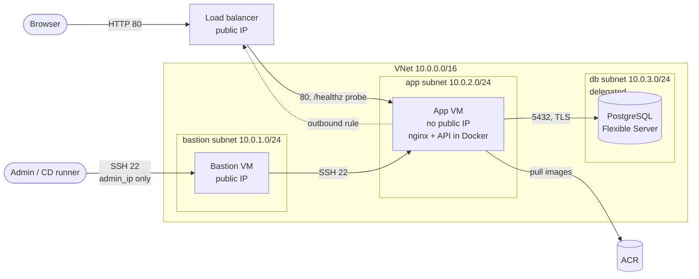

# Hoard on Azure

This folder builds the production environment for Hoard:

- a virtual network with three subnets, each behind its own network security group (NSG);
- a bastion VM, the only SSH entry point;
- the app VM, in a private subnet with no public IP;
- a Standard Load Balancer that serves the app on a public IP;
- an Azure Database for PostgreSQL Flexible Server, reachable only from the app subnet;
- an Azure Container Registry (ACR) that CD pushes images to.

The state is kept in Azure Storage, so the team and the CD pipeline share one copy. The outputs feed Ansible's dynamic inventory, so no address is copied by hand.

## Architecture



| Subnet | Accepts | Denies |
| --- | --- | --- |
| `bastion` | SSH from `admin_ip` (and, during a deploy, from the CD runner) | Everything else, including the rest of the VNet |
| `app` | SSH from the bastion subnet; HTTP 80 from the internet (through the load balancer) and from the load balancer's probe | Everything else, including the rest of the VNet |
| `db` | 5432 from the app subnet; traffic inside its own subnet | Everything else, including the rest of the VNet |

The app VM has no public IP and its subnet has Azure's default outbound access turned off. It reaches apt and the registry through the load balancer's outbound rule.

## Layout

```
terraform/
├── bootstrap.sh            # creates the state storage account and writes backend.hcl
├── backend.hcl.example     # what bootstrap.sh writes
├── versions.tf             # Terraform, provider versions and the azurerm backend
├── main.tf                 # calls the modules and sets the subnet rules
├── deployer.tf             # roles for the CD identity
├── variables.tf            # everything set in terraform.tfvars
├── locals.tf               # tags added to every resource
├── outputs.tf              # addresses and names for Ansible and CD
└── modules/
    ├── network/            # resource group, VNet, subnets, one NSG per subnet and its rules
    ├── compute/            # NIC, VM and an optional public IP (used twice: bastion and app)
    ├── loadbalancer/       # public IP, LB, backend pool, probe, HTTP rule and outbound rule
    ├── database/           # private DNS zone, PostgreSQL Flexible Server and the hoard database
    └── registry/           # Azure Container Registry, Basic tier, admin user off
```

- **`modules/network`** takes a map of subnets. Each gets an NSG, and each rule is its own `azurerm_network_security_rule`, generated with `for_each`. Separate rule resources mean the temporary rule CD adds for its runner is not seen as drift. The module refuses a rule that opens port 22 to the whole internet.
- **`modules/compute`** is used for both VMs. `public_ip = true` gives the bastion its address; the app VM leaves it off.
- **`modules/database`** generates the admin password with `random_password` (letters and digits, because it sits in a Postgres URL). It is a sensitive output and only lives in the state.
- **`deployer.tf`** gives the GitHub Actions identity the least it needs: Reader on the resource group, AcrPush on the registry and Network Contributor on the bastion NSG. Nothing is created when `deployer_principal_id` is unset.

## Cost

Approximate monthly prices in South Africa North, before free credits:

| Resource | Size | About |
| --- | --- | --- |
| App VM and bastion VM | `Standard_B2ats_v2` each | $8 each |
| PostgreSQL Flexible Server | `B_Standard_B1ms`, 32 GB | $15 |
| Standard Load Balancer and two public IPs | | $25 |
| Container Registry | Basic | $5 |
| State storage | Standard LRS, a few KB | under $1 |

Run `terraform destroy` when the environment is not needed.

## Prerequisites

- [Terraform](https://developer.hashicorp.com/terraform/install) 1.6 or newer
- [Azure CLI](https://learn.microsoft.com/cli/azure/install-azure-cli), signed in with `az login` to a subscription you can create resources and role assignments in (Owner, or Contributor plus User Access Administrator)
- An SSH key pair. Password login is disabled on both VMs.

```bash
ssh-keygen -t ed25519 -f ~/.ssh/hoard -N ""
```

## 1. Create the state storage (once)

```bash
cd terraform
./bootstrap.sh hoard-yourname southafricanorth
```

The script creates `hoard-yourname-tfstate-rg` with a storage account (TLS 1.2, no public blobs, shared keys off, versioning and 7-day soft delete on), gives you **Storage Blob Data Contributor** on it, creates the `tfstate` container and writes `backend.hcl`. Running it again reuses the same account. `backend.hcl` is gitignored.

## 2. Configure

```bash
cp terraform.tfvars.example terraform.tfvars
```

| Name | What to put |
| --- | --- |
| `subscription_id` | `az account show --query id -o tsv` |
| `prefix` | A short name unique to you, such as `hoard-chioma`. Lowercase letters, digits and hyphens, 4–20 characters. |
| `location` | A region your subscription allows, such as `southafricanorth` |
| `admin_ip` | Your public IP with `/32` (`curl -4 ifconfig.me`). SSH to the bastion is accepted only from here. |
| `ssh_public_key_path` | Default `~/.ssh/hoard.pub` |
| `vm_size`, `bastion_vm_size`, `db_sku_name` | Defaults are the cheapest sizes that work |
| `deployer_principal_id` | Object ID of the CD service principal (see the main README). Leave out until it exists. |

`terraform.tfvars` is gitignored.

## 3. Init, plan, apply

```bash
terraform init -backend-config=backend.hcl
terraform plan
terraform apply
```

The first apply creates 39 resources (42 with `deployer_principal_id`) and takes about 10 minutes, most of it the database. If it fails with `SkuNotAvailable`, set another size or region; `az vm list-skus -l <location> --size Standard_B -o table` lists what a region offers.

## Outputs

```bash
terraform output
```

| Output | Use |
| --- | --- |
| `app_url` | Where Hoard is served, through the load balancer |
| `load_balancer_ip` | The load balancer's public IP |
| `bastion_public_ip` | The only SSH entry point |
| `app_private_ip` | The app VM's address inside the VNet |
| `ssh_command` | Opens a shell on the app VM through the bastion (`ssh -J`) |
| `acr_name`, `acr_login_server` | Registry for `az acr login` and image names |
| `database_host`, `database_name`, `database_username` | Where the app connects |
| `database_password` | Sensitive: `terraform output -raw database_password` |
| `resource_group_name`, `bastion_nsg_name`, `app_vm_id` | Used by CD and for Azure CLI commands |

If SSH times out, your public IP has changed: update `admin_ip` and apply again.

## Destroy

```bash
terraform destroy
```

This removes everything above, including the database and its data. The state storage group is left in place; delete it with `az group delete -n hoard-yourname-tfstate-rg` once nothing uses it.
